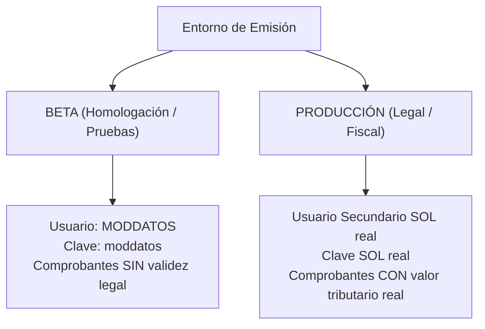

# 🇵🇪 Manual Oficial de Sincronización con SUNAT
## Guía Paso a Paso: Dónde y Cómo Obtener Certificado Digital y Credenciales SOL

Este manual explica detalladamente cómo obtener los accesos oficiales de la **SUNAT (Superintendencia Nacional de Aduanas y de Administración Tributaria)** necesarios para activar la facturación electrónica directa (SEE - Del Contribuyente UBL 2.1), sin intermediarios de pago (PSE/OSE).

---

## 📋 Resumen: ¿Qué datos solicita la plataforma?

Para emitir facturas, boletas y notas de crédito válidas legalmente ante SUNAT, en el menú **🏢 Mi Empresa** se solicitan:

| Dato Requerido | ¿Qué es? | ¿Dónde se obtiene? |
|---|---|---|
| **1. Certificado Digital (.pfx / .p12)** | Archivo criptográfico que firma legalmente cada XML (RSA-SHA256). | Gratuito en SUNAT SOL (Mypes) o comprado en entidad autorizada (Reniec, Llama.pe, etc.). |
| **2. Contraseña del Certificado** | Clave secreta definida al descargar o comprar el certificado. | La defines tú al generar o recibir el archivo `.pfx` o `.p12`. |
| **3. Usuario Secundario SOL** | Usuario operador con permisos específicos para emitir comprobantes. | Se crea dentro del portal SUNAT Operaciones en Línea (SOL). |
| **4. Clave SOL del Usuario Secundario** | Contraseña del usuario secundario creado en SOL. | La defines tú al crear el usuario secundario en SUNAT. |
| **5. Entorno (Beta vs Producción)** | Selector de pruebas sin valor legal o emisión real fiscal. | Se activa en la plataforma tras validar las credenciales. |

---

## 🔏 PASO 1: Obtención del Certificado Digital Tributario (.pfx / .p12)

Tienes dos alternativas legales aprobadas por INDECOPI y SUNAT:

### Opción A: Certificado Digital Tributario GRATUITO de SUNAT (Recomendada para Mypes)

De acuerdo con el **Decreto Legislativo N.° 1370** y la **R.S. N.° 038-2020/SUNAT**, SUNAT otorga un **Certificado Digital Tributario (CDT) 100% gratuito** con vigencia de 3 años para micro y pequeñas empresas.

#### Requisitos para acceder al certificado gratuito:
* Estar afecto al **Régimen MYPE Tributario (RMT)**, **Régimen Especial (RER)** o **Régimen General** con ingresos anuales netos menores a 300 UIT.
* RUC en estado **ACTIVO** y condición de domicilio fiscal **HABIDO**.
* No encontrarse sancionado con condena por delitos tributarios ni aduaneros.
* No contar con otro certificado tributario gratuito vigente emitido por SUNAT.

#### Procedimiento en SUNAT Operaciones en Línea (SOL):
1. Ingresa a la página oficial de SUNAT: [https://www.sunat.gob.pe](https://www.sunat.gob.pe)
2. Haz clic en **Operaciones en Línea (SOL)** > **Mis Trámites y Consultas** > **Ingresar**.
3. Inicia sesión con tu **RUC**, **Usuario** y **Clave SOL** principal (del titular o representante legal).
4. En el menú izquierdo, navega por la siguiente ruta:
   👉 **Empresas** > **Comprobantes de Pago** > **Certificado Digital Tributario - CDT** > **Solicitar Certificado Digital Tributario**.
5. Lee y acepta los términos del contrato de suscripción de la entidad de certificación (RENIEC / SUNAT).
6. Ingresa tu correo electrónico de contacto.
7. **Definir la Contraseña del Certificado:**
   * El sistema te solicitará ingresar una contraseña para proteger el certificado.
   * ⚠️ **¡MUY IMPORTANTE!** Anota y guarda bien esta contraseña. La necesitarás al subir el certificado a tu facturador.
8. Haz clic en **Generar Certificado** y luego en **Descargar**.
9. Obtendrás un archivo con extensión `.pfx` o `.p12` (ej: `20606636505.pfx`). Este es el archivo que subirás en el facturador.

> [!NOTE]
> Al obtener el CDT gratuito de SUNAT, este queda registrado y acreditado automáticamente en sus servidores; no requieres vincularlo manualmente.

---

### Opción B: Certificado Digital Comercial Privado (Para medianas y grandes empresas)

Si tu empresa supera las 300 UIT o deseas adquirir un certificado privado de entidad acreditada por INDECOPI:
1. Adquiérelo con proveedores autorizados:
   * **RENIEC:** [https://www.reniec.gob.pe](https://www.reniec.gob.pe)
   * **Llama.pe:** [https://llama.pe](https://llama.pe)
   * **Camerfirma Perú:** [https://www.camerfirma.pe](https://www.camerfirma.pe)
   * **Avansi:** [https://www.avansi.pe](https://www.avansi.pe)
2. Solicita el formato de entrega: **Software / Archivo PKCS#12 (`.pfx` o `.p12`)**.
3. **Vincular el certificado en SUNAT SOL:**
   * Ingresa a SUNAT SOL con tu clave principal.
   * Ve a: **Empresas** > **Comprobantes de Pago** > **Certificado Digital** > **Registrar Certificado Digital**.
   * Sube la clave pública (`.cer` o `.crt`) para autorizar a SUNAT a validar las firmas de tu empresa.

---

## 👤 PASO 2: Creación del Usuario Secundario SOL para Facturación

> [!CAUTION]
> **Norma de Seguridad de SUNAT:** **NUNCA** utilices el usuario y clave SOL principal (del representante legal) en sistemas de facturación automática. SUNAT exige crear un **Usuario Secundario** que únicamente tenga permisos para emitir comprobantes de pago.

#### Procedimiento paso a paso en SUNAT SOL:

1. Ingresa a **SUNAT Operaciones en Línea (SOL)** con tu clave SOL principal.
2. En la parte superior derecha de la pantalla, haz clic sobre el **Nombre de tu Empresa / Razón Social**.
3. En el menú desplegable, selecciona **Administración de Usuarios Secundarios**.
4. Haz clic en el botón **Crear Usuario**.
5. Completa los datos solicitados:
   * **Tipo de Documento:** DNI.
   * **Número de Documento:** DNI del operador o administrador del sistema.
   * **Nombre de Usuario:** Asigna un identificador corto (ejemplo: `FACTURADOR` o `MODDATOS`).
   * **Correo electrónico:** Correo de la empresa o administrador.
   * **Contraseña SOL:** Ingresa una clave segura de mínimo 8 caracteres (letras mayúsculas, minúsculas y números).
   * **Confirmar contraseña.**
6. Haz clic en **Siguiente**.

#### Asignación de Permisos de Facturación Electrónica:
7. En la pantalla de permisos, haz clic en **Asignar Programas**.
8. Despliega las siguientes ramas:
   * 📂 **Tributarios**
     * 📂 **Comprobantes de Pago**
       * 📂 **SEE - Desde los Sistemas del Contribuyente**
9. Marca las siguientes casillas indispensables:
   * `[✓]` **Factura Electrónica** (Emisión de Facturas, Notas de Crédito y Débito).
   * `[✓]` **Boleta de Venta Electrónica** (Emisión y Resumen Diario).
   * `[✓]` **Consultas de Validez de Comprobantes de Pago** (Consulta de CDR y validez).
   * `[✓]` **Guía de Remisión Electrónica** (Si vas a emitir guías de remisión remitente).
   * `[✓]` **Comunicaciones de Baja** (Para anulación de facturas).
10. Haz clic en **Siguiente** y luego en **Grabar**.
11. Verás el mensaje de confirmación con el nombre completo de tu usuario secundario (ej: `20606636505FACTURADOR`).

---

## 🧪 PASO 3: Entornos de Facturación (Beta vs Producción)

El sistema soporta dos modos de funcionamiento que puedes cambiar con un solo clic:



### 1. Entorno BETA / Pruebas:
* **Finalidad:** Probar que el diseño de comprobantes, cálculos de IGV, códigos QR y envío al servidor funcionen correctamente.
* **Usuario SOL:** `MODDATOS`
* **Clave SOL:** `moddatos`
* **Certificado:** Puedes usar tu certificado real o el emitido por SUNAT.
* **Validez Legal:** Ninguna. SUNAT acepta los comprobantes pero no generan cobro de impuestos ni se envían al libro de ventas.

### 2. Entorno de PRODUCCIÓN Real:
* **Finalidad:** Emisión oficial de comprobantes tributarios para clientes reales.
* **Usuario SOL:** El nombre del usuario secundario creado en el Paso 2 (ej: `FACTURADOR`). *Nota: La plataforma le antepone automáticamente tu número de RUC.*
* **Clave SOL:** La clave que asignaste a ese usuario secundario.
* **Certificado:** Tu archivo `.pfx` o `.p12` real con su contraseña.
* **Validez Legal:** 100% legal y fiscal ante SUNAT.

---

## 💻 PASO 4: Carga y Validación en el Facturador

1. Ingresa a tu plataforma de facturación (`https://facturador.tudominio.com`).
2. Inicia sesión con tu cuenta.
3. En el menú lateral, dirígete a **🏢 Mi Empresa**.
4. Desplázate hasta la sección **Credenciales SUNAT y Certificado Digital**:
   * **Usuario Secundario SOL:** Escribe tu usuario secundario (ej: `FACTURADOR`).
   * **Clave SOL:** Escribe la contraseña del usuario secundario.
   * **Certificado Digital (.pfx / .p12):** Haz clic en *Seleccionar .pfx* y carga tu archivo.
   * **Contraseña del Certificado:** Ingresa la contraseña con la que descargaste el archivo `.pfx`.
   * **Entorno de Facturación:**
     * Selecciona *Beta / Pruebas* si estás homologando.
     * Selecciona *Producción Real* cuando ya estés listo para facturar comercialmente.
5. Haz clic en el botón **🧪 Probar Conexión SUNAT**:
   * La plataforma verificará la desencriptación del certificado y realizará un saludo SOAP contra SUNAT.
   * Si todo está correcto, verás el mensaje verde:
     > *"Prueba exitosa: El Certificado Digital y las credenciales SOL de esta empresa se conectaron correctamente a SUNAT."*
6. Haz clic en **Guardar Configuración de Empresa**.

---

## ⚠️ PASO 5: Errores Frecuentes de SUNAT y Cómo Resolverlos

| Código de Error | Mensaje de SUNAT | Causa Principal | Solución |
|---|---|---|---|
| **0102 / 1034** | *El usuario o clave SOL son incorrectos* | Se ingresó la clave incorrecta o se escribió mal el usuario. | Verifica el usuario secundario y escribe de nuevo su clave SOL en *Mi Empresa*. |
| **1033** | *El usuario no tiene acceso al servicio* | El usuario secundario fue creado pero no se le marcaron los permisos de SEE. | Entra a SUNAT SOL > *Admin Usuarios Secundarios*, edita el usuario y marca los permisos de *SEE - Del Contribuyente*. |
| **0306 / 2153** | *Element {Invoice} had undefined attribute Id* / *Error en firma* | El certificado digital tiene una contraseña incorrecta o está corrupto. | Verifica que la contraseña del `.pfx` sea la exacta con la que se generó. |
| **2335** | *El certificado no fue emitido por una entidad autorizada* | Se usó un certificado digital no registrado o no emitido por entidad acreditada por INDECOPI. | Utiliza el Certificado Digital Tributario gratuito de SUNAT o adquiere uno con INDECOPI. |
| **2014** | *El número de RUC del emisor no coincide con el certificado* | El certificado digital `.pfx` pertenece a otra empresa o persona natural. | Verifica que el RUC configurado en la empresa coincida con el RUC impreso en el certificado digital. |
| **0100 - 0199** | *Aceptado con observaciones* | El comprobante **ha sido ACEPTADO y es legalmente válido**, pero SUNAT advierte un dato secundario (ej: dirección o código de distrito no homologado). | El comprobante es legal. Revisa la observación para corregir futuras emisiones. |

---

## 📍 Ubicación de este manual en el VPS

Este manual se encuentra disponible de forma permanente en tu servidor VPS en:
```bash
/var/www/facturador-sunat/MANUAL_INTEGRACION_SUNAT.md
```
Puedes leerlo directamente desde la consola SSH con:
```bash
cat /var/www/facturador-sunat/MANUAL_INTEGRACION_SUNAT.md | less
```
o abrirlo desde el navegador en la pestaña **Mi Empresa** de la plataforma.
